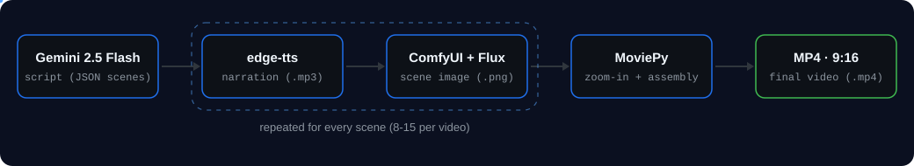

  

I'm Daniel, a second-year **Multiplatform Application Development (DAM)** student from Spain. I wrote my first line of code in 2024, and since then I've focused on two things: **backend development with Java** and **applying AI to real software**, from calling LLM APIs to running image models on my own GPU.

I learn by building things that work end to end, and I care about the parts nobody sees: clean structure, safe configuration and honest documentation.

- 🔭 Currently building **ParfumDex**, a Flutter + Firebase app
- 🌱 Learning **JavaFX** for desktop applications

## What I work with

**Languages** 

**Backend & data** 

**Apps & UI** 

**AI & automation** 

**Tools** 

## How I work

- **Layers with one job each.** Models, services and screens are separated, so a change in one place does not ripple through the rest.
- **Secrets stay out of the repo.** Credentials and per-project config files are git-ignored, and data access is protected with security rules.
- **Decisions and limits are written down.** My READMEs explain why things are built the way they are and list what doesn't work yet.

## Projects

### Featured

  
  

  

### Coursework and practice

Beyond the featured projects, most of what I've learned is in class projects and exercises:

| Repository | What's inside | Stack |
|---|---|---|
| [DAM_Prog_25-26](https://github.com/DanielMartinCordero/DAM_Prog_25-26) | Programming projects from my first year of DAM | Java |
| [DAM_Swing_26-27](https://github.com/DanielMartinCordero/DAM_Swing_26-27) | Assignments for the user interface development module | Java, Swing |
| [DAM_2627_Flutter](https://github.com/DanielMartinCordero/DAM_2627_Flutter) | Second-year Flutter coursework | Dart, Flutter |
| [python_2627](https://github.com/DanielMartinCordero/python_2627) | Second-year Python coursework | Python |
| [Simulador-Cloud-Computing](https://github.com/DanielMartinCordero/Simulador-Cloud-Computing) | Cloud computing simulator | Java, Maven |
| [Buscaminas](https://github.com/DanielMartinCordero/Buscaminas) | Minesweeper game | Java |
| [JavaStoreBackend](https://github.com/DanielMartinCordero/JavaStoreBackend) | Shopping cart system for a supermarket | Java |

## Activity

  <picture>
    <source media="(prefers-color-scheme: dark)" srcset="https://raw.githubusercontent.com/DanielMartinCordero/DanielMartinCordero/output/github-snake-dark.svg">
    <source media="(prefers-color-scheme: light)" srcset="https://raw.githubusercontent.com/DanielMartinCordero/DanielMartinCordero/output/github-snake.svg">
    
  </picture>

  

📫 danikai1902@gmail.com · [LinkedIn](https://www.linkedin.com/in/YOUR-HANDLE)
